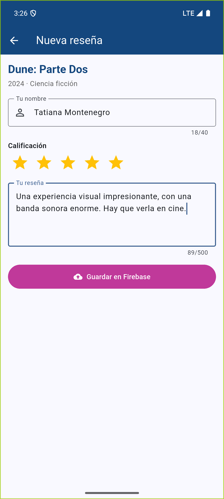
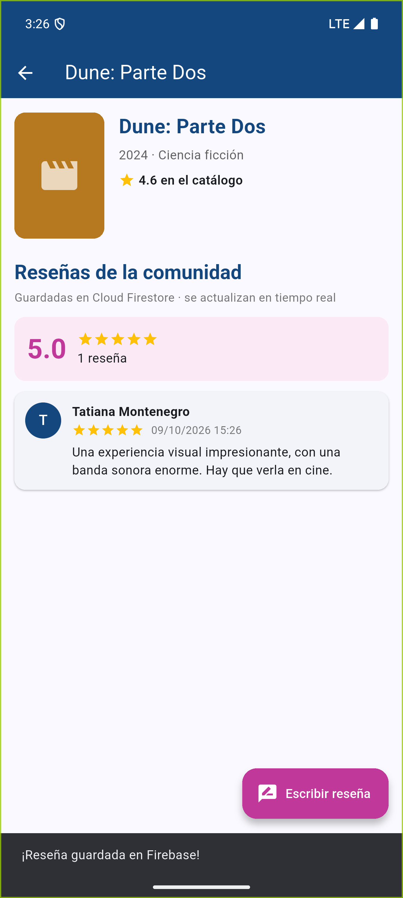
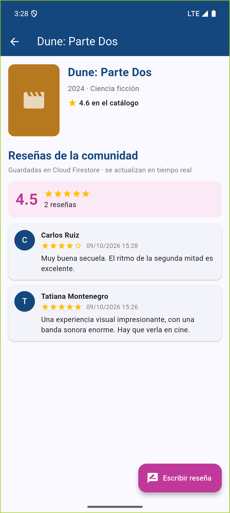
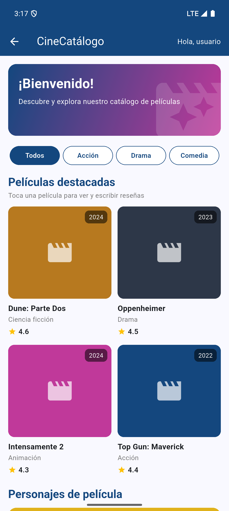
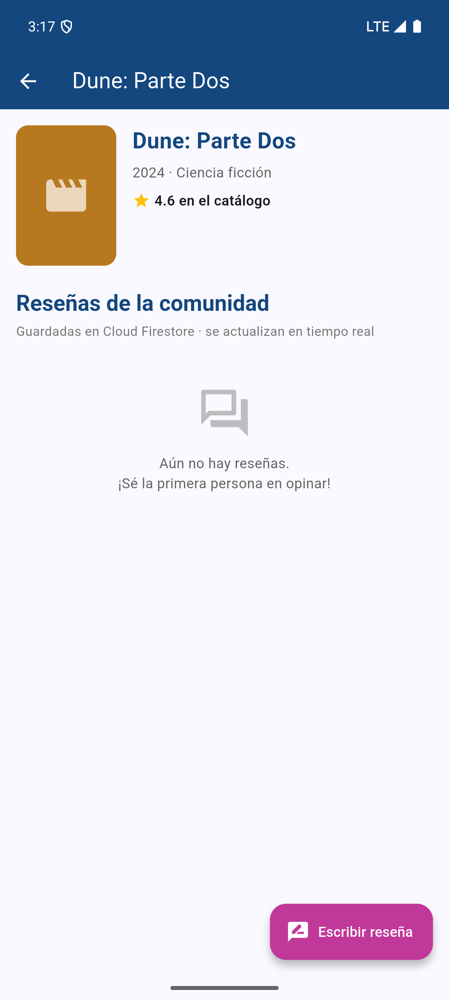
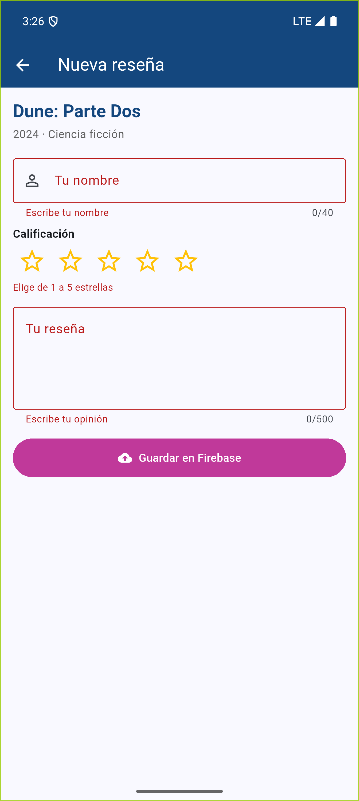
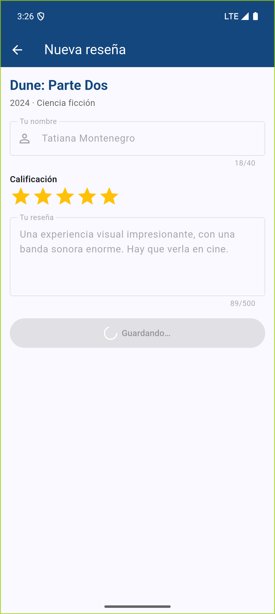
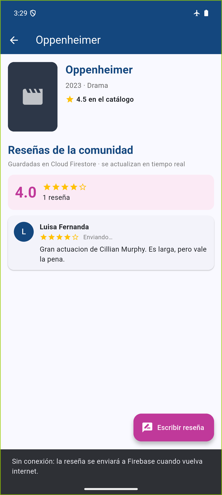
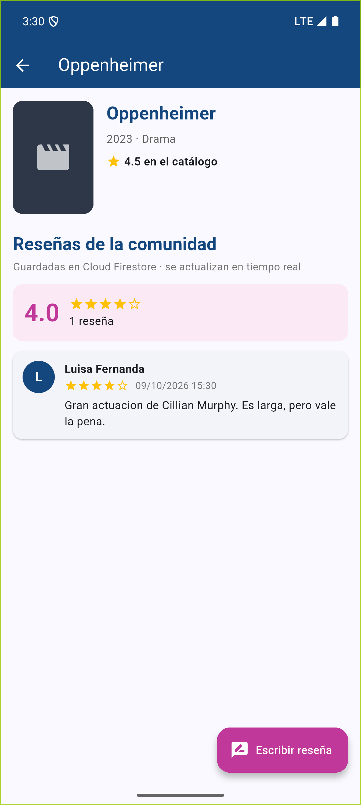

# LDSW_Firebase — CineCatálogo

Aplicación móvil de catálogo de películas desarrollada en Flutter. En esta actividad se **integra Firebase** a la app: cada película del catálogo tiene una ficha donde se pueden **escribir reseñas que se guardan en Cloud Firestore** y se muestran en tiempo real.

Continúa lo desarrollado en [LDSW_Widgets](https://github.com/tatiana1398/LDSW_Widgets), [LDSW_Layouts](https://github.com/tatiana1398/LDSW_Layouts) y [LDSW_PeticionesHTTP](https://github.com/tatiana1398/LDSW_PeticionesHTTP): Inicio → Catálogo → **Ficha de la película** → **Nueva reseña**.

- **Participante:** Tatiana Montenegro Domínguez
- **Asignatura:** Programación Móvil
- **Asesor(a):** Gabriel Peralta Domínguez

<p>



</p>

## Procedimiento ("Add Firebase to your Flutter app")

1. **Instalar las herramientas:** Firebase CLI (`npm install -g firebase-tools`) e iniciar sesión con `firebase login`; FlutterFire CLI (`dart pub global activate flutterfire_cli`).
2. **Crear el proyecto de Firebase** `ldsw-cinecatalogo` (`firebase projects:create`).
3. **Crear la base de datos** Cloud Firestore (`firebase firestore:databases:create`, ubicación `nam5`).
4. **Agregar los paquetes** a la app: `flutter pub add firebase_core cloud_firestore`.
5. **Configurar la app** con `flutterfire configure`, que registra las apps de **Android, iOS y web** en el proyecto y genera:
   - [`lib/firebase_options.dart`](lib/firebase_options.dart) con la configuración de cada plataforma,
   - `android/app/google-services.json` y `ios/Runner/GoogleService-Info.plist`,
   - el plugin `com.google.gms.google-services` en Gradle.
6. **Inicializar Firebase** en [`lib/main.dart`](lib/main.dart) antes de `runApp`:

```dart
Future<void> main() async {
  WidgetsFlutterBinding.ensureInitialized();
  await Firebase.initializeApp(
    options: DefaultFirebaseOptions.currentPlatform,
  );
  runApp(const CineCatalogoApp());
}
```

7. **Agregar y leer datos** con Cloud Firestore en [`lib/services/resenas_service.dart`](lib/services/resenas_service.dart).
8. **Publicar las reglas de seguridad** ([`firestore.rules`](firestore.rules)) con `firebase deploy --only firestore:rules`.

## Cómo se guardan los datos

Cada reseña es un documento en la subcolección `peliculas/{peliculaId}/resenas`:

| Campo | Tipo | Ejemplo |
|---|---|---|
| `autor` | string | "Tatiana Montenegro" |
| `calificacion` | number (1 a 5) | 5 |
| `comentario` | string | "Una experiencia visual impresionante…" |
| `fecha` | timestamp (la pone el servidor) | 9 oct 2026, 15:26 |

```dart
/// Agregar: crea un documento nuevo con los datos del formulario.
final doc = _resenas(peliculaId).doc();
await doc.set({
  'autor': autor.trim(),
  'calificacion': calificacion,
  'comentario': comentario.trim(),
  'fecha': FieldValue.serverTimestamp(),
}).timeout(espera);

/// Leer: escucha la colección en tiempo real, de la más nueva a la más antigua.
Stream<List<Resena>> escucharResenas(String peliculaId) {
  return _resenas(peliculaId)
      .orderBy('fecha', descending: true)
      .snapshots()
      .map((consulta) => consulta.docs.map(Resena.fromDocument).toList());
}
```

- **Agregar datos:** [`NuevaResenaScreen`](lib/screens/nueva_resena_screen.dart) es un formulario con validación (nombre, estrellas y comentario). Al guardar llama a `agregarResena()` y regresa con el mensaje *"¡Reseña guardada en Firebase!"*.
- **Leer datos en tiempo real:** [`PeliculaDetalleScreen`](lib/screens/pelicula_detalle_screen.dart) usa un `StreamBuilder` sobre `snapshots()`, así que una reseña nueva aparece sin recargar la pantalla, aunque se agregue desde otro dispositivo. También calcula el promedio de estrellas.
- **Sin conexión:** Firestore guarda la reseña en el teléfono y la envía cuando vuelve internet. Si el servidor no confirma en 10 s, la app avisa al usuario.

### Reglas de seguridad

[`firestore.rules`](firestore.rules) permite **leer** y **agregar** reseñas, pero solo si los datos son válidos (nombre de 1 a 40 caracteres, calificación entera de 1 a 5, comentario de 1 a 500 caracteres y fecha del servidor). No se permite modificar ni borrar reseñas desde la app.

## Evidencias

Capturas en el emulador Android Pixel 9 Pro XL (API 35), conectado al proyecto real de Firebase ([`docs/evidencias`](docs/evidencias)):

| | | |
|---|---|---|
| <br>1. Catálogo: tocar una película | <br>2. Ficha sin reseñas (lectura de Firestore) | <br>3. Validación del formulario |
| <br>4. Formulario lleno | <br>5. Guardando en Firebase | <br>6. Reseña guardada |
| <br>7. Reseña agregada desde fuera de la app aparece sola | <br>8. Sin conexión: queda pendiente | <br>9. Al volver la red se sincroniza |

- [`datos_firestore.txt`](docs/evidencias/datos_firestore.txt): documentos guardados en Cloud Firestore, consultados con la API REST.
- [`log_firestore.txt`](docs/evidencias/log_firestore.txt): registro de la app en el emulador al guardar las reseñas.
- [`reglas_seguridad.txt`](docs/evidencias/reglas_seguridad.txt): las reglas rechazan datos inválidos y borrados.
- [`resultado_pruebas.txt`](docs/evidencias/resultado_pruebas.txt): `flutter analyze` sin errores y 17 pruebas aprobadas.

## Pruebas

[`test/resenas_test.dart`](test/resenas_test.dart) usa [`fake_cloud_firestore`](https://pub.dev/packages/fake_cloud_firestore) para simular la base de datos sin depender de internet:

- `agregarResena` crea el documento con los datos limpios y la fecha.
- `escucharResenas` ordena de la más nueva a la más antigua y solo trae las de esa película.
- El formulario no guarda si faltan datos.
- Agregar una reseña la muestra en la lista con el promedio.
- Sin internet se avisa que la reseña se enviará después.
- Sin desbordes en una pantalla pequeña.

[`test/widget_test.dart`](test/widget_test.dart) conserva las pruebas de la actividad anterior (PokéAPI).

## Estructura

```
lib/
├── main.dart                          # Inicializa Firebase, tema y colores
├── firebase_options.dart              # Generado por flutterfire configure
├── models/
│   ├── pelicula.dart                  # Películas del catálogo (con id)
│   ├── resena.dart                    # Reseña (fromDocument / nueva)
│   └── personaje.dart                 # Personajes de PokéAPI
├── services/
│   ├── resenas_service.dart           # Agregar y leer reseñas en Firestore
│   └── pokeapi_service.dart           # Peticiones HTTP (actividad anterior)
├── widgets/
│   ├── estrellas.dart                 # Calificación con estrellas
│   └── tipo_chip.dart
└── screens/
    ├── inicio_screen.dart             # Inicio
    ├── catalogo_screen.dart           # Catálogo (tarjetas abren la ficha)
    ├── pelicula_detalle_screen.dart   # Ficha + reseñas en tiempo real
    ├── nueva_resena_screen.dart       # Formulario para agregar una reseña
    ├── personajes_screen.dart
    └── personaje_detalle_screen.dart
firestore.rules                        # Reglas de seguridad de Firestore
firebase.json / .firebaserc            # Configuración de Firebase CLI
```

## Cómo ejecutar

```bash
flutter pub get
flutter run          # en un emulador o dispositivo con internet
flutter test         # pruebas
flutter analyze      # análisis estático (sin errores)
```

La configuración de Firebase ya está incluida (`firebase_options.dart`, `google-services.json`, `GoogleService-Info.plist`), así que la app se conecta al proyecto `ldsw-cinecatalogo` sin pasos adicionales.

### Material de apoyo

- [Firebase y Flutter (documentación de Flutter)](https://docs.flutter.dev/data-and-backend/firebase)
- [Agregar Firebase a tu app de Flutter (guía oficial)](https://firebase.google.com/docs/flutter/setup)
- [Cloud Firestore para Flutter](https://firebase.google.com/docs/firestore/quickstart)

Probado en el emulador Android Pixel 9 Pro XL (API 35) con Flutter 3.47.6 (Dart 3.13.5).
